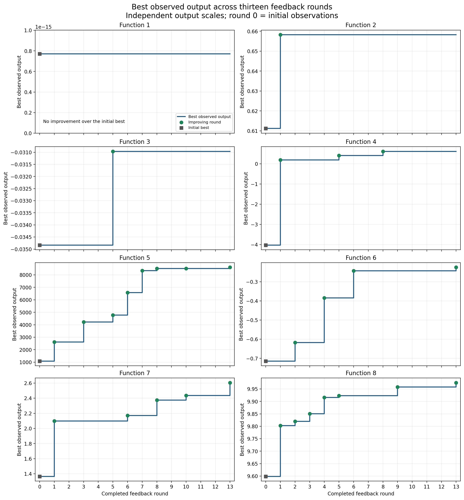
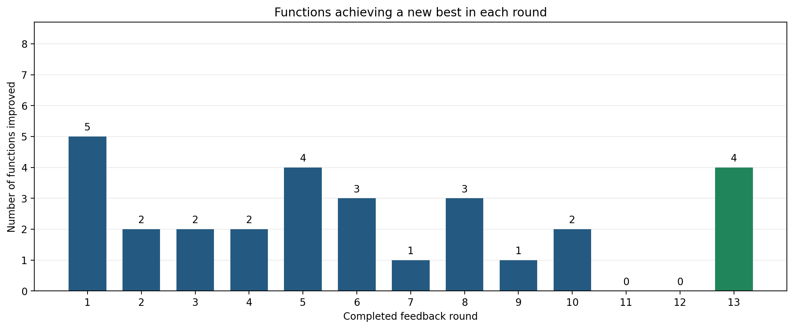

# Black-box optimisation capstone

**Author:** Beatriz Echauz | **Final evaluation:** CP_25 | **Status:** 13 completed rounds | **Documentation updated:** 26 October 2026

## Non-technical explanation

This project explores how to improve results when a system can be tested but its internal workings are unknown. I investigated eight simulated problems, using earlier results to choose the next experiment. Over thirteen rounds, I added 104 tests to 175 supplied observations. Seven problems improved beyond their starting best, and four achieved new best results in the final round. My approach combined searching unfamiliar areas with refining promising ones. The results show useful progress, but do not prove that the best possible solutions were found. The repository records the decisions, predictions, observed outcomes and limitations so others can review them.

## Start here

- [Final evaluation notebook](CP_25.ipynb): validated data, final outcomes, historical prediction errors and charts.
- [Dataset datasheet](docs/DATASHEET.md) and [model card](docs/MODEL_CARD.md).
- [Reproducibility and execution](docs/REPRODUCIBILITY.md).
- [Strategy development](docs/STRATEGY_EVOLUTION.md).
- [Module 23 presentation](presentations/Beatriz_Echauz_BBO_Methodology_CP23.pdf): historical snapshot, not final results.
- [Final tables and figures](results/final_evaluation/).
- [Activity requirements mapping](docs/ACTIVITY_ALIGNMENT.md), [terms and attribution](docs/TERMS.md), and [changelog](CHANGELOG.md).

## Data

The Imperial College London / Emeritus capstone supplied 175 initial numerical observations for eight unknown functions. I added one portal evaluation per function in each of 13 rounds, producing **279 observed input-output pairs**. The source formulas and global optima are unknown. All functions are maximised; coordinates are in the unit-cube domain, with submission coordinates formatted to six decimals below 1.

`initial_data/function_*/` contains the supplied NumPy arrays. `week_1/` through `week_13/` contain cumulative snapshots; they must not be appended to one another. Earlier snapshots are reconstructed prefixes, not evidence of original file dates. The round-13 files retain the supplied cumulative file bytes. The data is small enough to include directly; no large external dataset is required. See the datasheet for provenance, omissions and permitted uses.

## Model

I fitted one Gaussian Process per function with coordinate-specific Matérn length scales, target normalisation and a white-noise component. Most rounds ranked sampled candidates by UCB, the predicted mean plus twice predictive standard deviation. Later searches combined 100,000 global candidates with 10,000 candidates at each of two local scales (0.10 and 0.03 per coordinate).

Auxiliary models included a small neural network for Function 5 and linear regression for Function 7. They supplied diagnostic predictions, not the acquisition uncertainty. Classification experiments, regional diagnostics and PCA added perspectives; PCA did not remove coordinates from optimisation. No reinforcement-learning agent was implemented.

## Hyperparameter optimisation

Early experiments compared length-scale bounds. CP_18 compared six GP configurations using three-fold cross-validation: Matérn smoothness 1.5 or 2.5 and alternative length-scale intervals. Later notebooks retained the selected configurations while refitting continuous kernel parameters. The final selected smoothness is 1.5 for Functions 1-5 and 2.5 for Functions 6-8; upper length-scale bounds are 10 for Functions 2, 4 and 8 and 2 for the others, with lower bound 0.02.

CP_24 compared uncertainty weights 0, 1 and 2 on shared candidate pools. The final round used **highest predicted mean**, retaining global and local pools. Function 5's additional minimum distance of 0.01 was removed; the general duplicate tolerance remained. Extra optimiser restarts checked its numerical stability. These comparisons did not evaluate the outputs of all alternative proposals.

## Results

| Function | Dimensions | Initial observations | Final observations | Initial best | Final best | Improvement |
|---|---:|---:|---:|---:|---:|---:|
| 1 | 2 | 10 | 23 | 7.71087511e-16 | 7.71087511e-16 | 0 |
| 2 | 2 | 10 | 23 | 0.611205216 | 0.658239509 | 0.0470342928 |
| 3 | 3 | 15 | 28 | -0.0348353134 | -0.030963913 | 0.00387140032 |
| 4 | 4 | 30 | 43 | -4.02554228 | 0.615272937 | 4.64081522 |
| 5 | 4 | 20 | 33 | 1088.85962 | 8605.85251 | 7516.99289 |
| 6 | 5 | 20 | 33 | -0.714264948 | -0.224677015 | 0.489587932 |
| 7 | 6 | 30 | 43 | 1.3649683 | 2.6049592 | 1.2399909 |
| 8 | 8 | 40 | 53 | 9.598482 | 9.97527317 | 0.376791172 |

Seven functions improved over their initial best. Rounds 11 and 12 produced no new maxima; round 13 improved Functions 5, 6, 7 and 8. Each function has its own scale, so improvements are not summed into a score. The hidden benchmark score, leaderboard rank and global-optimum gaps are not inferred from these values.





Prediction quality and optimisation progress differ. Function 7's final output exceeded its historical forecast by about 3.55 predicted standard deviations despite achieving a new best. These individual residuals are not a complete calibration assessment.

## Repository structure

| Location | Contents |
|---|---|
| `CP_12.ipynb` to `CP_24.ipynb` | Historical query rounds 1-13 |
| `CP_25.ipynb` | Final evaluation without further queries |
| `initial_data/` | Supplied initial arrays |
| `week_1/` to `week_13/` | Cumulative feedback snapshots |
| `results/final_evaluation/` | Authoritative final summaries and figures |
| `results/` other files | Historical CP_21 snapshot, documented in its README |
| `docs/` | Datasheet, model card, methods and reproduction notes |
| `presentations/` | Historical Module 23 presentation |
| `scripts/validate_data.py` | Independent final-data and export checks |

## Run locally

From the repository root, create an environment and install dependencies:

```powershell
python -m venv .venv
.\.venv\Scripts\python.exe -m pip install -r requirements.txt
.\.venv\Scripts\python.exe scripts/validate_data.py
.\.venv\Scripts\python.exe -m jupyterlab
```

On macOS/Linux use `.venv/bin/python` instead. Open `CP_25.ipynb`, select this environment's kernel, and run its cells in order. Keep the notebook working directory at the repository root. This reproduces the final evaluation and exports without fitting new models or contacting the portal.

Historical notebook reruns require the matching weekly snapshot and may produce small numerical or candidate-selection differences across software versions. See [reproduction notes](docs/REPRODUCIBILITY.md) before interpreting saved outputs. The dependency list is not a reconstruction of every historical environment.

## Contact

[Beatriz Echauz on GitHub](https://github.com/BeatrizEchauz)
